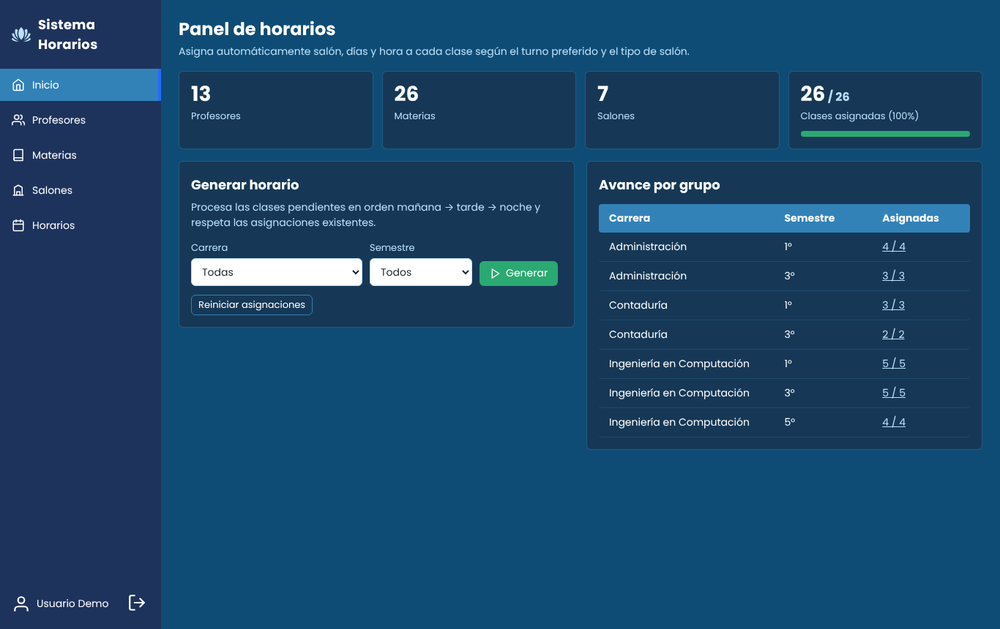
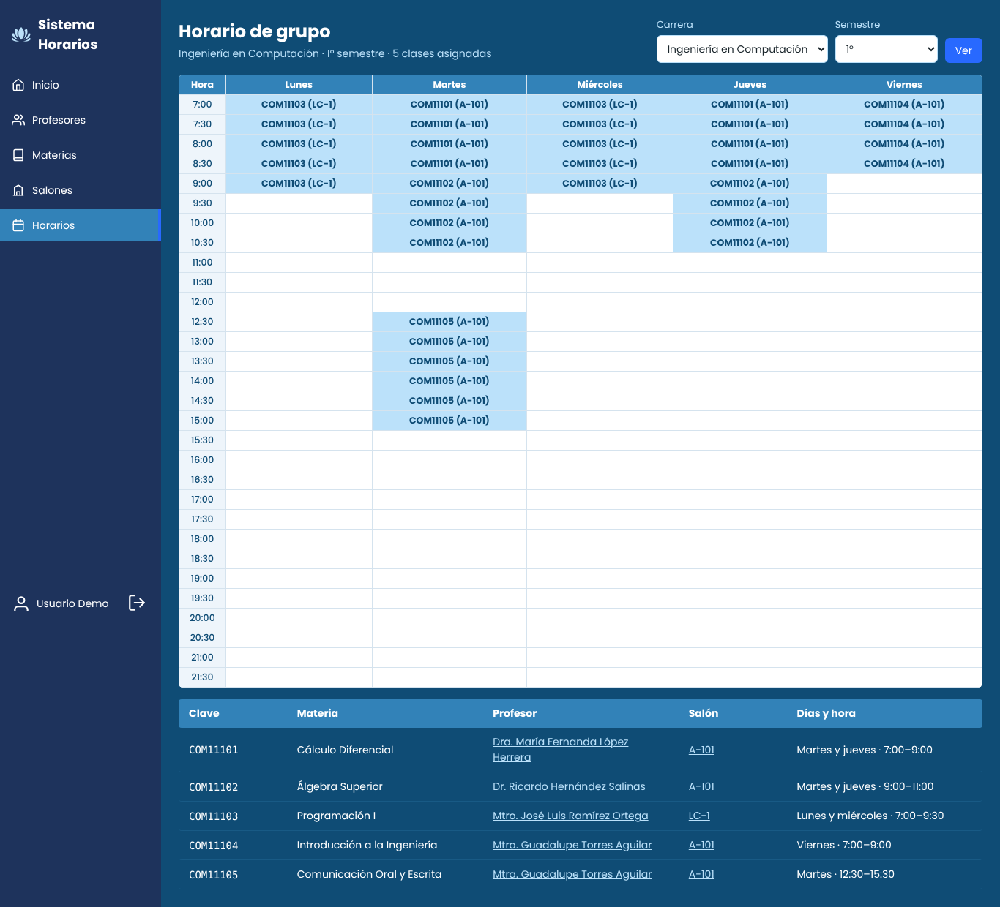
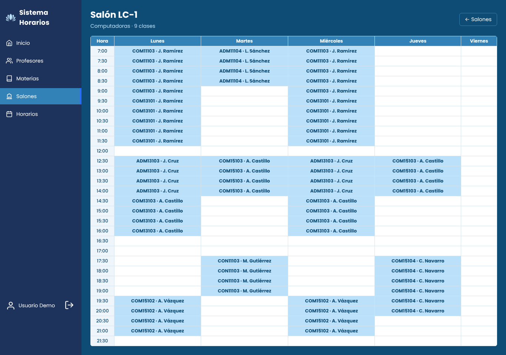
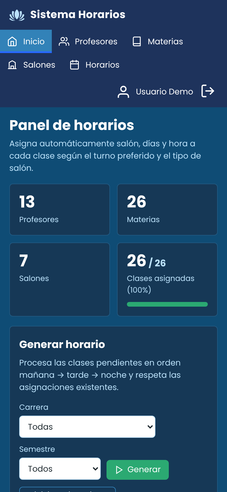
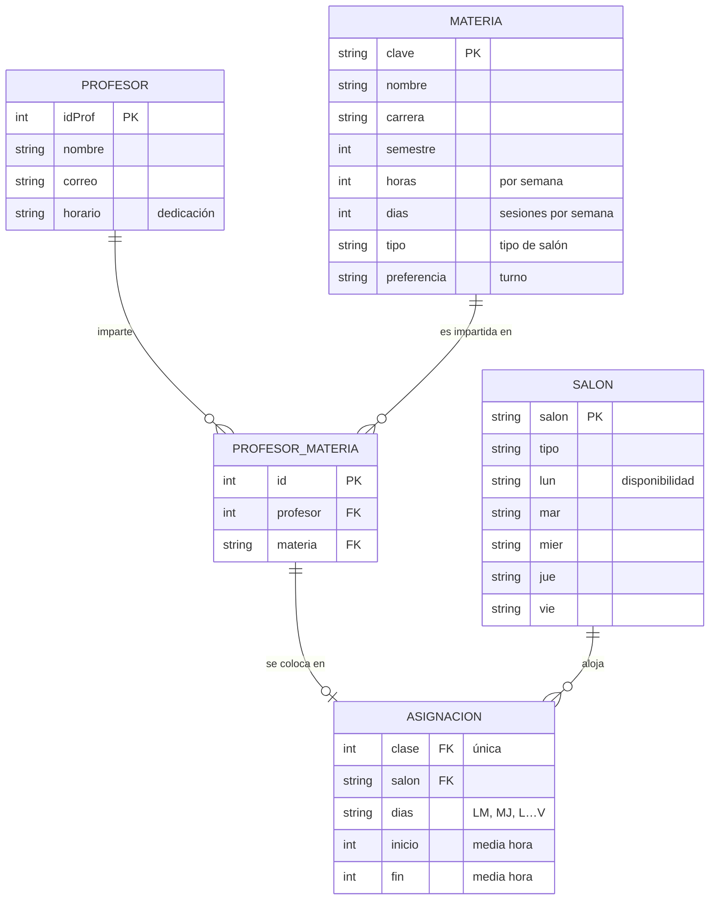
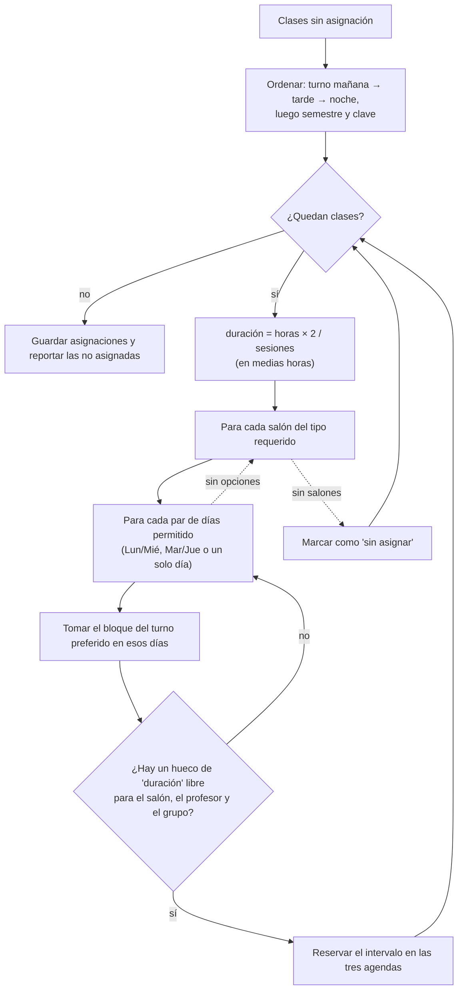

# Sistema de Horarios

**Versión 1 · Aplicación web con Django**

[Inicio rápido](#inicio-rápido) · [Arquitectura](#arquitectura) · [Evolución a FastAPI + OR-Tools](https://github.com/Aloner23/sistHorario)

[](https://github.com/Aloner23/sistHorarios/actions/workflows/ci.yml)

**Para evaluarlo:** sigue el inicio rápido y entra con la cuenta local `demo / demo`. Explora el panel y las vistas de horarios por grupo, profesor y salón. Esta es la aplicación Django; la [versión 2](https://github.com/Aloner23/sistHorario) separa la interfaz de una API y modela el horario con programación por restricciones.

> **English summary:** A Django web app that builds weekly class timetables for a university. Given professors, courses (hours per week, preferred shift, room type) and classrooms (availability by morning/afternoon/evening block), a greedy scheduler assigns each class a room, days and time with no room, professor or student-group clashes. Includes a dashboard, per-professor / per-room / per-group timetables, manual assignment with conflict validation, demo data, 51 automated tests and CI.

Aplicación web en **Django** para generar los horarios semanales de una facultad: asigna a cada clase (profesor + materia) un salón, días y hora, respetando el turno preferido, el tipo de salón y la disponibilidad, sin que choquen salones, profesores ni grupos.



## Funcionalidades

- **Generación automática** del horario de todas las clases pendientes, o filtrado por carrera y semestre. Respeta las asignaciones que ya existen.
- **Restricciones que respeta**: tipo de salón (aula de butacas, laboratorio de cómputo, laboratorio), turno preferido (mañana, tarde o noche), bloques cerrados de cada salón, horas semanales de la materia y sesiones por semana. Además evita que se empalmen salones, profesores y grupos (carrera + semestre).
- **Vistas de horario** en rejilla de medias horas (7:00–22:00) por profesor, por salón y por grupo.
- **Asignación manual** de salón con validación de choques.
- CRUD de profesores y alta de materias por profesor; catálogos completos en el admin de Django.
- Panel con avance por grupo y lista de clases pendientes.
- Inicio de sesión con `django.contrib.auth`; diseño responsivo.

| Horario de grupo | Horario de salón | Móvil |
|---|---|---|
|  |  |  |

## Inicio rápido

Requiere Python 3.11 o superior.

```bash
pip install -r requirements.txt
DEBUG=True python manage.py migrate && DEBUG=True python manage.py seed_demo --generar
DEBUG=True python manage.py runserver
```

Abre <http://127.0.0.1:8000> y entra con **demo / demo** (usuario que crea `seed_demo` sólo para desarrollo local).

> En vez de anteponer `DEBUG=True` puedes copiar `.env.example` a `.env`. Sin `DATABASE_URL`, la app usa SQLite y no hace falta instalar nada más.

## Arquitectura

```
sistHoraios/            # proyecto Django (settings, urls, wsgi)
generator/
├── scheduler.py        # algoritmo puro, sin Django → fácil de probar
├── services.py         # puente ORM ↔ algoritmo, validación de conflictos
├── models.py           # Profesor, Materia, Salon, ProfesorMateria, Asignacion
├── views.py, forms.py  # vistas basadas en funciones
├── management/commands/seed_demo.py
├── templates/html/     # base.html + páginas
└── tests/              # pytest + pytest-django
```

### Modelo de datos



Se conservan los nombres de tabla del esquema MySQL original (`profesores`, `materias`, `salones`, `profesores_has_materias`, `salones_has_profesores_has_materias`).

### Cómo funciona el algoritmo

El día se modela como **30 medias horas** desde las 7:00 (índice `0`) hasta las 22:00 (índice `30`). Cada salón publica por día una cadena con tres bloques, mañana, tarde y noche, en el formato original del proyecto: `"0-10,11-20,21-30,"`, donde `x` marca un bloque cerrado.



Es un algoritmo **voraz (greedy)**: coloca cada clase en el primer hueco válido, sin retroceder. La complejidad es aproximadamente *O(clases × salones × huecos)*, de sobra para el tamaño de una facultad. No garantiza la solución óptima; si una clase no cabe, se reporta en el panel para asignarla a mano.

La lógica vive en `generator/scheduler.py` como funciones puras (`generar_horario`, `parse_disponibilidad`, `construir_grilla`…), así que se prueba sin base de datos.

#### Correcciones respecto a la versión original

La primera versión del algoritmo (`pr.py`, con consultas `pymysql`) se portó conservando la idea, pero con estas correcciones:

1. Tomaba el **último** salón disponible en lugar del primero y podía salirse de los límites de la tupla.
2. Asignaba la clase **aunque no cupiera** en el bloque y reconstruía mal la cadena de disponibilidad (con turno mañana sobrescribía el inicio del bloque de la tarde).
3. Calculaba la duración con `int(horas / dias)`: una materia de 5 h en 2 sesiones quedaba en 2 h por sesión. Ahora se usan medias horas (2.5 h).
4. Las materias de una sola sesión semanal se asignaban igual a dos días.
5. Sólo evitaba choques de salón; ahora tampoco se empalman **profesores ni grupos**.
6. Si no había salón, fallaba con `UnboundLocalError`; ahora la clase se reporta como pendiente.

## Stack

- Python 3.11+ · Django 5.2 LTS
- SQLite (desarrollo) · MySQL o PostgreSQL vía `DATABASE_URL`
- python-decouple, dj-database-url, WhiteNoise, Gunicorn
- pytest + pytest-django, Ruff, GitHub Actions
- HTML y CSS propios, sin frameworks ni CDNs

## Variables de entorno

| Variable | Valor por defecto | Descripción |
|---|---|---|
| `DEBUG` | `False` | `True` sólo en desarrollo. |
| `SECRET_KEY` | *(obligatoria si `DEBUG=False`)* | Clave larga y aleatoria. |
| `ALLOWED_HOSTS` | `localhost,127.0.0.1` | Dominios separados por coma. |
| `CSRF_TRUSTED_ORIGINS` | *(vacío)* | Ej. `https://mi-app.onrender.com`. |
| `DATABASE_URL` | SQLite en `db.sqlite3` | `mysql://…` o `postgres://…`. |
| `SECURE_SSL_REDIRECT` | `False` | Redirigir a HTTPS cuando `DEBUG=False`. |
| `TIME_ZONE` | `America/Mexico_City` | Zona horaria. |

Revisa `.env.example`.

## Pruebas y calidad

```bash
pip install -r requirements-dev.txt
pytest            # 51 pruebas
ruff check . && ruff format --check .
```

Las pruebas cubren el algoritmo (sin traslapes de salón, profesor ni grupo; horas semanales cubiertas; turno y tipo de salón respetados; los casos que la versión original resolvía mal), los modelos, la validación de conflictos y las vistas principales con los datos de `seed_demo`. El flujo de [CI](.github/workflows/ci.yml) corre lint y pruebas en Python 3.11, 3.12 y 3.13, verifica que no falten migraciones y simula un arranque con `DEBUG=False`.

## Despliegue

El `Procfile` sirve para plataformas tipo Heroku, como Render o Railway:

```
web: gunicorn sistHoraios.wsgi:application --log-file -
release: python manage.py migrate --noinput
```

1. Crea una base de datos PostgreSQL o MySQL y define `DATABASE_URL`.
2. Define `SECRET_KEY`, `ALLOWED_HOSTS` y `CSRF_TRUSTED_ORIGINS` con tu dominio.
3. Build command: `pip install -r requirements.txt && python manage.py collectstatic --noinput`.
4. Para MySQL instala también `mysqlclient`; para PostgreSQL, `psycopg[binary]`.
5. Crea un administrador con `python manage.py createsuperuser`. No uses `seed_demo` en producción: crea el usuario `demo/demo`, a menos que pases `--sin-usuario`.

WhiteNoise sirve los archivos estáticos, así que no hace falta un servidor aparte.

## Roadmap

- [ ] Restricciones de disponibilidad por profesor (días u horas en que no puede dar clase).
- [ ] Optimización con retroceso o un solver de restricciones (p. ej. OR-Tools) para llenar los huecos que deja el algoritmo voraz.
- [ ] Exportar horarios a PDF o iCal.
- [ ] Editor visual de disponibilidad de salones en lugar de la cadena `a-b,`.
- [ ] Varios periodos escolares y grupos por materia.

## Autor

**Carlos** · [@Aloner23](https://github.com/Aloner23)

Proyecto original (2023), modernizado en 2026 con configuración por entorno, migraciones, algoritmo refactorizado y probado, CI y documentación.

Licencia [MIT](LICENSE).
